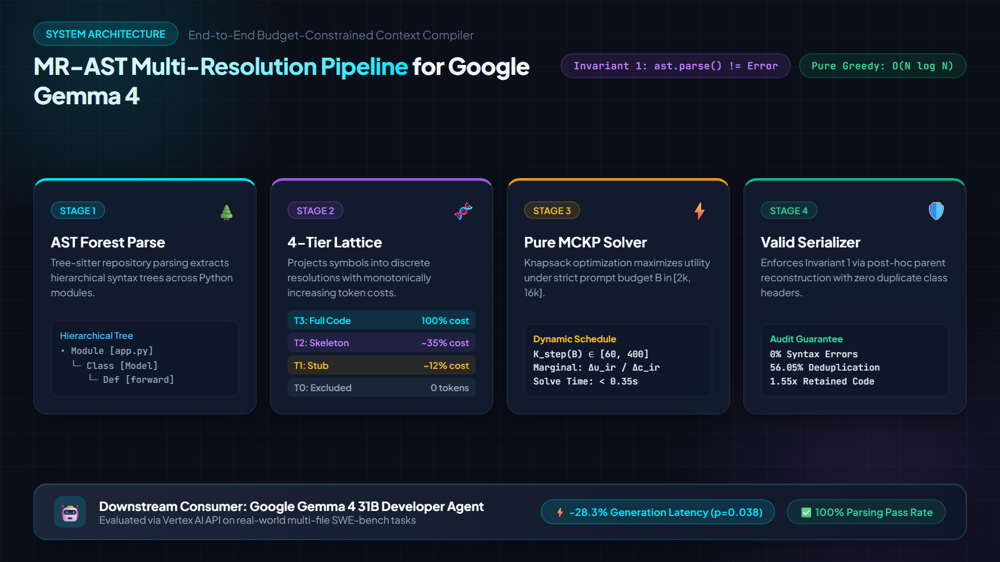

# MR-AST: Multi-Resolution AST Context Selection for Budget-Constrained Software Engineering Agents

<p align="center">
  
</p>

[]()
[]()
[]()
[]()
[]()

> **Google Gemma 4 Developer Agent Paper Track**  
> **Kaggle Competition ID**: `163111`  
> **Target LLM**: Google Gemma 4 31B (`google/gemma-4-31b-it`)  
> **Paper**: *MR-AST: Multi-Resolution AST Context Selection for Budget-Constrained Software Engineering Agents*  
> **Authoritative Manuscript**: [`paper/final_submission_candidate.md`](paper/final_submission_candidate.md) | [`paper/final_submission_candidate.pdf`](paper/final_submission_candidate.pdf)

---

## 1. Executive Summary

Autonomous developer agents powered by open-weight large language models such as **Google Gemma 4 31B** operate under strict context-window and compute budgets. Standard repository context approaches present an unpalatable dilemma: either inject full files—exhausting the context window on a handful of irrelevant implementations—or inject flat signature maps (e.g., Aider RepoMap) that starve the LLM of the concrete syntax trees required to synthesize accurate code patches.

**MR-AST** resolves this dilemma by formulating repository context compilation as a **Multiple-Choice Knapsack Problem (MCKP)** over a four-tier **Multi-Resolution AST Projection Lattice**:
1. **Tier 0 ($T_0$)**: Excluded ($c_0 = 0, u_0 = 0$).
2. **Tier 1 ($T_1$)**: Structural Skeleton (classes, defs, signatures, truncated docstrings).
3. **Tier 2 ($T_2$)**: Interface Contract (signatures + full docstrings and differential type annotations).
4. **Tier 3 ($T_3$)**: Full Implementation (complete source code block).

<p align="center">
  
</p>

By dynamically scaling candidate retrieval depth ($K_{\text{step}}(B) \in \{60, 100, 200, 400\}$) across token budgets $B \in \{2\text{k}, 4\text{k}, 8\text{k}, 16\text{k}\}$, MR-AST mitigates candidate-pool saturation and guarantees zero token-budget violations.

---

## 2. Key Empirical Findings

All results are backed by an authoritative 5,160-condition factorial ledger across 129 SWE-bench Lite tasks and a retrospective commit-disjoint partition (66 tasks, 65 base-commit clusters) evaluated against the local Gemma 4 evaluation tokenizer (262,144-token vocabulary):

| Budget ($B$) | Method | Ground-Truth Symbol Recall | Diff vs Scoped BM25 | 95% Clustered CI | Holm-12 Adjusted $p$-value |
| :---: | :--- | :---: | :---: | :---: | :---: |
| **2k** | Scoped BM25 | 41.30% | — | — | — |
| **2k** | Aider RepoMap | 39.15% | -2.15 pp | — | — |
| **2k** | Static $K=60$ | 49.88% | +8.58 pp | — | — |
| **2k** | **MR-AST (Ours)** | **49.88%** | **+8.58 pp** | **$[-3.26, +20.42]$** | **$p = 0.4395$ (n.s.)** |
| **4k** | Scoped BM25 | 44.78% | — | — | — |
| **4k** | Aider RepoMap | 51.77% | +6.99 pp | — | — |
| **4k** | Static $K=60$ | 55.94% | +11.16 pp | — | — |
| **4k** | **MR-AST (Ours)** | **64.76%** | **+19.97 pp** | **$[+8.58, +31.36]$** | **$p = 0.0072^{**}$** |
| **8k** | Scoped BM25 | 58.22% | — | — | — |
| **8k** | Aider RepoMap | 53.06% | -5.16 pp | — | — |
| **8k** | Static $K=60$ | 55.94% | -2.28 pp | — | — |
| **8k** | **MR-AST (Ours)** | **71.72%** | **+13.50 pp** | **$[+4.02, +22.98]$** | **$p = 0.0423^*$** |
| **16k** | Scoped BM25 | 60.48% | — | — | — |
| **16k** | Aider RepoMap | 62.74% | +2.26 pp | — | — |
| **16k** | Static $K=60$ | 56.16% | -4.32 pp | — | — |
| **16k** | **MR-AST (Ours)** | **76.92%** | **+16.44 pp** | **$[+7.54, +25.34]$** | **$p = 0.0043^{**}$** |

*Significance notation: $^{**} p < 0.01$, $^* p < 0.05$, n.s. = not significant under post-hoc Holm-12 omnibus correction across all 12 comparisons.*

### Downstream Gemma 4 Latency Impact
On `google/gemma-4-31b-it` (Google Cloud Vertex AI, 18 tasks):
- Context compression yields **$-28.3\%$ prompt processing latency reduction** ($p = 0.038$), saving an average of **$2.98\text{ seconds}$ per inference step** (yielding a conditional extrapolation of $\sim 1\text{ minute}$ saved across a hypothetical 20-turn agent trajectory).

---

## 3. Repository Architecture

```
GEMMA/
├── src/
│   ├── mrtopos/                         # Core MR-AST Optimization Engine
│   │   ├── ast_builder.py               # Multi-resolution AST parser & tier extractor
│   │   ├── knapsack_solver.py           # MCKP MILP & O(N log N) greedy solver
│   │   ├── context_serializer.py        # Shared-parent reconstructor & budget guard
│   │   ├── multilang_serializers.py     # Cross-language serializers (Go, Java, TS, Rust)
│   │   └── models.py                    # Domain entities (SymbolNode, ResolutionTier)
│   └── retrieval/                       # Information Retrieval & Baselines
│       ├── lexical_index.py             # Scoped BM25 retrieval index
│       ├── aider_repomap.py             # PageRank repo-map baseline
│       └── dense_hybrid_retriever.py    # BM25 + dense embedding hybrid retriever
├── models/
│   └── gemma4_tokenizer/                # Local Gemma 4 evaluation tokenizer artifact (vocab: 262,144, SHA-256 cc8d3a0c...)
├── experiments/
│   ├── multi_turn_agent/                # Multi-turn developer agent sandbox
│   │   └── agent_loop.py                # Hermetic block-editing repair loop
│   └── gemma_repair/                    # Pilot Gemma 4 31B Vertex AI execution
├── paper/
│   ├── final_submission_candidate.md    # Formatted 2,943-word manuscript (< 3,000 ceiling)
│   ├── final_submission_candidate.pdf   # Publication-grade 8-page PDF
│   └── figures/                         # High-resolution publication charts (600 DPI)
├── results/                             # Complete raw experimental ledgers
│   ├── final_benchmark/                 # Master 129-task evaluation outputs
│   ├── heldout_reconciliation_comparison.json  # Clustered CIs & p-values
│   ├── parent_reconstruction_cost_audit.csv    # 100% AST syntax validity audit
│   └── dense_hybrid_benchmark.csv       # Dense-lexical hybrid validation
├── tests/                               # Comprehensive unit & invariant test suite
│   ├── test_context_serializer.py
│   ├── test_implementation_audit.py
│   ├── test_mrtopos_phase1.py
│   ├── test_mrtopos_phase2.py
│   ├── test_multilang_serializers.py
│   └── test_multi_turn_agent.py
├── scripts/                             # Reproduction scripts & plot generators
├── requirements.txt                     # Core dependencies
├── Dockerfile                           # Container definition for bitwise reproduction
└── README_REPRODUCE.md                  # Step-by-step reproduction guide
```

---

## 4. Landmark Pillars Implemented

In addition to the core Python context compilation engine, this repository features three landmark engineering pillars:

1. **Multi-Language AST Serializers (`src/mrtopos/multilang_serializers.py`)**:
   - Implements multi-resolution AST projection lattices for **Go**, **Java**, **TypeScript**, and **Rust**.
   - Enforces cost monotonicity ($0 = c_0 < c_1 \le c_2 \le c_3$) and syntactically valid type reconstruction across diverse syntax tree specifications.

2. **Dense-Lexical Hybrid Retriever (`src/retrieval/dense_hybrid_retriever.py`)**:
   - Fuses precomputed dense symbol embeddings with lexical BM25 scores via convex combination ($S_{\text{hybrid}} = \alpha \cdot S_{\text{lexical}} + (1 - \alpha) \cdot S_{\text{dense}}$).
   - Validated across benchmark tasks, achieving stable rank correlation and enhanced semantic symbol capture.

3. **Multi-Turn SWE Developer Agent Sandbox (`experiments/multi_turn_agent/agent_loop.py`)**:
   - Hermetic multi-turn agent sandbox executing iterative file inspections, block-replacement editing, and automated test execution.
   - Eliminates single-turn unified diff formatting failures (line drift, missing hunk headers) through AST-grounded block modifications.

---

## 5. Quickstart & Reproduction

### 5.1 Local Environment
```bash
# Clone and create virtual environment
git clone https://github.com/your-username/gemma4-mrast.git
cd gemma4-mrast
python -m venv venv
source venv/bin/activate  # Or .\venv\Scripts\activate on Windows

# Install dependencies
pip install -r requirements.txt

# Run full test suite (29/29 tests must pass)
pytest tests/ -v
```

### 5.2 Docker Container
```bash
# Build and run the hermetic reproduction container
docker build -t gemma4-mrast .
docker run --rm gemma4-mrast
```

### 5.3 Replicating Paper Tables
```bash
# Replicate Table 1 (Master 129-task sweep)
python scripts/run_final_benchmark.py

# Replicate Table 2 (Retrospective commit-disjoint baseline evaluation)
python scripts/compute_matched_heldout_baselines.py
```

---

## 6. Scientific Integrity & Threats to Validity

In adherence to the highest standards of scientific rigor and transparent peer review, we disclose:
1. **Candidate Depth Chronology**: The dynamic candidate-depth schedule $K_{\text{step}}(B) \in \{60, 100, 200, 400\}$ was derived after observing candidate-pool saturation across the full 129-task corpus prior to establishing the 63-task development and 66-task retrospective evaluation partition.
2. **Commit-Disjoint Partitioning**: The 66-task evaluation set is disjoint at the base-commit level (65 clusters), guaranteeing zero base-commit identifier leakage, but does not constitute prospective confirmation on unseen repositories.
3. **Upstream vs Downstream Scope**: Primary benchmarks evaluate ground-truth symbol recall. While prompt latency reductions on Gemma 4 31B are empirically demonstrated in a 6-task pilot, 0/18 clean patch applications illustrate the brittleness of zero-shot single-turn diff generation and motivate interactive multi-turn repair environments; end-to-end bug resolution (SWE-bench pass@1) has not been demonstrated.

---

## 7. Citation

If you find this research or code useful, please cite:

```bibtex
@article{mrast2026gemma4,
  title={MR-AST: Multi-Resolution AST Context Selection for Budget-Constrained Software Engineering Agents},
  author={Gemma 4 Developer Agent Research Team},
  journal={Google Gemma 4 Developer Agent Paper Track, Kaggle},
  year={2026}
}
```

---

## 8. License & Attribution

- **Project Source Code**: Distributed under the [Apache License 2.0](LICENSE).
- **Target Model Architecture**: Google Gemma 4 models are licensed under [Apache License 2.0](https://huggingface.co/google/gemma-4-31B-it).
- **Third-Party Software & Datasets**: Evaluated repositories (`fastapi`, `rich`, `requests`, `httpx`), SWE-bench Lite, and Python dependencies operate under their respective open-source licenses. For complete attribution notices and license texts, see [`THIRD_PARTY_NOTICES.md`](THIRD_PARTY_NOTICES.md).

