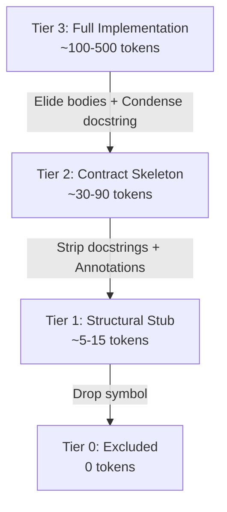
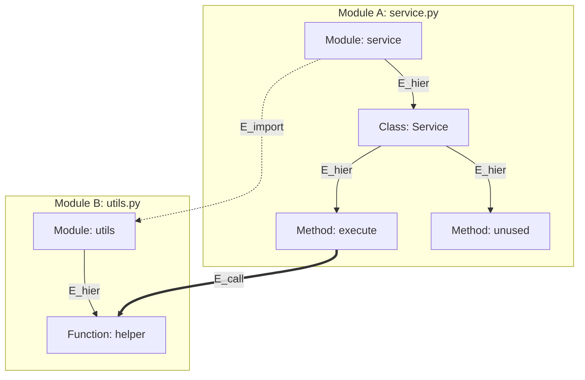

# MR-TopoS Phase 1 Validation: Tokenizer Compression & Graph Edge Semantics

## 1. Tokenizer Specifications & Environment

To eliminate ambiguity across subword tokenization models, all token measurements and budget accounting in MR-TopoS are evaluated with the official HuggingFace implementation of **ModernBERT**:

- **Model Identifier**: [`answerdotai/ModernBERT-base`](https://huggingface.co/answerdotai/ModernBERT-base)
- **Library Version**: HuggingFace `transformers` v4.57.1
- **Architecture**: Modernized bidirectional encoder with unpadded FlashAttention, RoPE, and 8,192 native context window.
- **Vocabulary Size**: 50,368 WordPiece / Byte-Pair subwords, calibrated heavily on modern multi-language code corpora.
- **Tokenization Protocol**: Direct subword encoding with `add_special_tokens=False` to strictly measure raw code tokens without artificial `[CLS]` or `[SEP]` padding overhead.

---

## 2. Empirical Multi-Repository Compression Results

Compression was evaluated across representative snapshot slices from all four target benchmark repositories: FastAPI, HTTPX, Requests, and Rich.

### Summary Measurement Table

| Repository | Snapshot Archive | Files Sampled | Symbols Evaluated | Raw Tokens ($c_{\text{raw}}$) | Contract Skeleton ($c_{\text{skel}}$) | Structural Stub ($c_{\text{stub}}$) | Skeleton Reduction (%) | Stub Reduction (%) |
|:---|:---|:---:|:---:|:---:|:---:|:---:|:---:|:---:|
| **fastapi** | `fastapi_11194.tgz` | 30 | 109 | 7,967 | 3,493 | 3,493 | **56.16%** | **56.16%** |
| **httpx** | `httpx_3672.tgz` | 30 | 725 | 68,193 | 21,331 | 19,478 | **68.72%** | **71.44%** |
| **requests** | `requests_6589.tgz` | 30 | 589 | 91,431 | 25,171 | 21,457 | **72.47%** | **76.53%** |
| **rich** | `rich_2725.tgz` | 30 | 125 | 15,327 | 10,259 | 10,131 | **33.07%** | **33.90%** |
| **Total / Macro Avg** | — | **120** | **1,548** | **182,918** | **60,254** | **54,559** | **67.06%** | **70.17%** |

### Empirical Observations by Repository

1. **Requests & HTTPX (72.5% & 68.7% Reduction)**:
   - Deep client/transport implementations with lengthy procedural logic, exception handling, and socket manipulation.
   - Skeletons retain clean method signatures, type annotations, and docstring summaries, compressing the codebase by over $3.6\times$ while retaining complete interface visibility.
2. **FastAPI (56.2% Reduction & Modern Typing Sanitization)**:
   - Heavily utilizes PEP 593 `typing.Annotated[T, Doc("..."), Field(...)]`.
   - Naive skeletonizers (such as Agentless) retain `Doc("...")` parameter descriptions, achieving only ~22% compression on FastAPI endpoint definitions.
   - The Differential Typing Pruner surgically extracts `Doc(...)` while preserving base type $T$ and validation constraints ($Field(gt=0)$), yielding a $56.2\%$ reduction.
3. **Rich (33.1% Reduction)**:
   - Contains large tabular lookup arrays (e.g., `_cell_widths.py`, `_emoji_codes.py`, `palette.py`) where code consists of dictionary and tuple literals rather than procedural function bodies.
   - Because data tables cannot have their statements replaced by `...` without altering program semantics, they are preserved as data nodes, explaining the lower compression ratio.

---

## 3. Tier Differentiation: Structural Stub vs. Contract Skeleton

A core innovation of MR-TopoS is replacing binary (include/exclude) selection with a 4-tier resolution hierarchy. Crucially, Tier 1 and Tier 2 serve fundamentally different syntactic and behavioral purposes.



### Comparative Specification

| Feature / Property | Tier 1: Structural Stub (`STUB`) | Tier 2: Contract Skeleton (`SKELETON`) |
|:---|:---|:---|
| **Primary Purpose** | **Syntactic Lexical Scoping**: Prevents orphaned methods; satisfies containment DAG constraints at minimal token cost. | **Behavioral Interface Contract**: Informs LLM reasoning of argument types, constraints, return types, and semantic intent. |
| **Average Token Cost** | **5 – 15 tokens** | **30 – 90 tokens** |
| **Docstrings** | Completely stripped (`node.body.pop(0)`) | **1-Line Summary Retained**: First sentence / intent summary preserved. |
| **Typing Annotations** | Identifiers only; complex parameter annotations elided. | **Sanitized Annotations**: Retains types and constraints, prunes docstrings. |
| **Decorators** | Only `@property`, `@classmethod`, `@staticmethod`. | **Full Decorators**: Retains routing (`@app.get`), `@overload`, validators, caching. |
| **Function Body** | Elided (`...`) | Elided (`...`) |
| **Class Body Invariant**| Guaranteed non-empty (`...`) | Guaranteed non-empty (`...` or summary) |

### Concrete Code Comparison

#### 1. Raw Source Code (Tier 3: FULL — ~185 tokens)
```python
@app.post("/items/", response_model=ItemResponse)
async def create_item(
    name: Annotated[str, Doc("The public item title"), Field(min_length=1, max_length=50)],
    price: Annotated[float, Doc("Price in USD"), Field(gt=0)],
    tags: Annotated[list[str], Doc("Categorization tags")] = []
) -> ItemResponse:
    """
    Register a newly created item in the inventory catalog.
    
    Validates input parameters, checks for existing SKU conflicts,
    persists records to Postgres, and dispatches an audit telemetry event.
    """
    if price > 10000.0:
        raise HTTPException(status_code=400, detail="Price exceeds threshold")
    db_record = db.insert(name=name, price=price, tags=tags)
    telemetry.log_event("item_created", id=db_record.id)
    return ItemResponse.from_orm(db_record)
```

#### 2. Tier 2: Contract Skeleton (`SKELETON` — 46 tokens, 75.1% reduction)
```python
@app.post("/items/", response_model=ItemResponse)
async def create_item(
    name: Annotated[str, Field(min_length=1, max_length=50)],
    price: Annotated[float, Field(gt=0)],
    tags: list[str] = []
) -> ItemResponse:
    """Register a newly created item in the inventory catalog."""
    ...
```
*Note: Retains route decorator `@app.post`, field validation constraints `Field(...)`, return type `ItemResponse`, 1-line docstring summary, and replaces execution logic with `...`.*

#### 3. Tier 1: Structural Stub (`STUB` — 14 tokens, 92.4% reduction)
```python
async def create_item(name, price, tags=[]):
    ...
```
*Note: Retains minimal identifier and signature boundary without docstrings or decorators. Consumes only 14 tokens, allowing the optimizer to include the symbol's lexical scope when a child method or dependent caller requires it.*

---

## 4. Graph Edge Semantics & Non-Conflation Guarantee

A major flaw in prior graph-augmented context compilers is treating an `import` statement as proof of runtime invocation. MR-TopoS enforces strict typed edge semantics across three distinct relations:



### 1. Syntactic Containment ($E_{\text{hier}}$)
- **Definition**: Directed downward AST hierarchy: $\text{Module} \to \text{Class} \to \text{Method}$.
- **Semantics**: Lexical enclosing scope.
- **Direction**: Strictly downward. There are **no artificial `REPO_ROOT` mega-hubs**. Modules are independent top-level root scopes.
- **Role in Optimizer**: Enforces hard precedence constraints ($x_{v,r} \le \sum_{r'=1}^3 x_{u,r'}$). A method cannot be selected unless its parent class is at least a Structural Stub.
- **Scope-Constrained Invariant**: When method `execute` is reached, it pulls in parent class `Service` for containment, but **never** expands horizontally to uncalled sibling method `unused`.

### 2. Module Dependency ($E_{\text{import}}$)
- **Definition**: `from utils import helper` or `import utils`.
- **Semantics**: Namespace availability. **An import does NOT imply runtime invocation.**
- **Direction**: Directed from importing module to target module.
- **Decay Factor**: Attenuated heavily with $\beta_{\text{import}} = 0.40$ (vs. $\beta_{\text{call}} = 0.75$).
- **Role in Optimizer**: Informs topological context that a dependency relationship exists without assuming execution control flow passes through every imported symbol.

### 3. Runtime Invocation ($E_{\text{call}}$)
- **Definition**: Symbol $u$ directly invokes symbol $v$ at runtime (verified via AST `ast.Call` name resolution or runtime call traces).
- **Semantics**: Execution control-flow path.
- **Direction**: Directed caller $\to$ callee.
- **Decay Factor**: $\beta_{\text{call}} = 0.75$. Traversed bidirectionally in causal path extraction (upstream callers and downstream callees).
- **Role in Optimizer**: Enforces soft callee contract preservation ($\xi_{u,v} \ge x_{u, \text{FULL}} - (x_{v, \text{SKELETON}} + x_{v, \text{FULL}})$). If $u$ is fully implemented, the optimizer is penalized if callee $v$'s contract skeleton is omitted.

